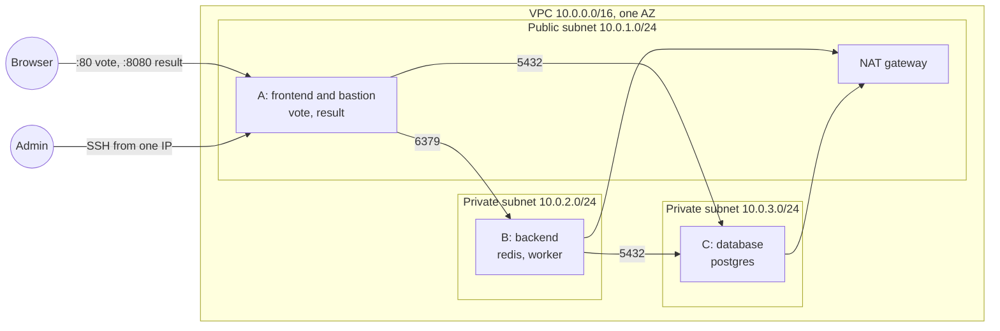

# Voting app on AWS with Terraform and Ansible

A polyglot voting app (Python vote, Node result, .NET worker, Redis, Postgres) deployed to three EC2 instances. Terraform builds the network and hosts, Ansible installs Docker and runs the containers through a bastion. Forked from [Pokfinner/ironhack-project-1](https://github.com/Pokfinner/ironhack-project-1), itself based on Docker's example voting app.

## Architecture



| Host | Subnet | Containers | Accepts |
|---|---|---|---|
| A frontend (bastion) | public | vote (80), result (8080) | 80 and 8080 from anywhere, SSH from the admin IP |
| B backend | private | redis (6379), worker | 6379 and SSH from A only |
| C database | private | postgres (5432) | 5432 from A and B, SSH from A only |

Images: `nitramabuar/vote`, `nitramabuar/result`, `nitramabuar/worker` on Docker Hub. A fork that changes `vote/`, `result/` or `worker/` builds and pushes its own images, then sets its Docker Hub user as `dockerhub_user` in `ansible/group_vars/all/vars.yml` and exports `DOCKERHUB_USER` for compose. Otherwise it runs the public images above.

## Run it locally

```bash
export DOCKERHUB_USER=your-user   # optional, defaults to nitramabuar
docker compose up -d --wait
# vote: http://localhost:8080  result: http://localhost:8081
docker compose down -v
```

## Checks

`scripts/check.sh` runs every check: `terraform fmt` and `terraform validate`, TFLint with the AWS ruleset, Checkov (Terraform, Ansible, the Dockerfiles, the workflow and committed secrets), ansible-lint, ShellCheck, hadolint and actionlint. It reports every failure in one run and exits non-zero if any check failed. GitHub Actions runs the same script on every push and pull request (`.github/workflows/checks.yml`). The workflow pins the versions of Terraform, TFLint, Checkov, ansible-lint, hadolint and actionlint, takes ShellCheck from the runner image, and locks its actions with GitHub's workflow lockfile. GitHub runs no workflows on a fork until you enable them in its Actions tab.

```bash
tflint --init   # once, fetches the TFLint AWS ruleset
scripts/check.sh
```

An accepted finding carries its reason in a `checkov:skip` or `hadolint ignore` comment next to the code.

## Deploy to AWS

Requirements: Terraform 1.11 or newer, Ansible (ansible-core 2.17 or newer), `ssh-keygen` and `openssl` for step 0, and AWS credentials that can manage S3, VPC and EC2 and read the SSM parameter that holds the Ubuntu AMI (`ssm:GetParameter`). The stack bills by the hour while it is up (the NAT gateway and the three instances), so tear it down when you are done.

To use your own names, set `owner`, `name_prefix` and, if you want, `region` in both modules: in `infra/main/terraform.tfvars`, and for `infra/bootstrap`, which has no tfvars example, with `-var` or a `terraform.tfvars` of your own. The course account only allows `us-east-1` and `eu-central-1`, so no other region passes validation.

A fresh fork needs its own key and vault, because the tracked `ansible/group_vars/all/vault.yml` is encrypted with the original owner's password. The database password must be hex: the result app puts it unencoded in a `postgresql://` URL and the worker in a `;` separated connection string.

```bash
# 0. Your own SSH key and vault (once)
ssh-keygen -t ed25519 -N '' -f ~/.ssh/ironhack-project-1
mkdir -p ~/.ansible && (umask 077 && openssl rand -hex 32 > ~/.ansible/ironhack-project-1.vault-pass)
printf 'vault_db_password: "%s"\n' "$(openssl rand -hex 16)" > ansible/group_vars/all/vault.yml
ansible-vault encrypt --vault-password-file ~/.ansible/ironhack-project-1.vault-pass ansible/group_vars/all/vault.yml

# 1. State bucket (once)
cd infra/bootstrap && terraform init && terraform apply   # also writes infra/main/backend.hcl

# 2. Network and hosts
cd ../main
cp terraform.tfvars.example terraform.tfvars   # then set admin_cidr to your public IPv4 as a /32, e.g. 203.0.113.7/32
terraform init -backend-config=backend.hcl && terraform apply

# 3. Containers
cd ../..
ansible-galaxy collection install -r ansible/requirements.yml
ansible-playbook -i ansible/inventory.ini --vault-password-file ~/.ansible/ironhack-project-1.vault-pass ansible/site.yml
ansible-playbook -i ansible/inventory.ini --vault-password-file ~/.ansible/ironhack-project-1.vault-pass ansible/smoke.yml
```

`terraform -chdir=infra/main output` prints the vote and result URLs.

## Design notes

- Remote state lives in S3 with S3 native locking (`use_lockfile`). Terraform has deprecated DynamoDB based locking.
- Security groups chain tier to tier: Redis only accepts the frontend, Postgres only the frontend and backend, and SSH to private hosts only comes through the bastion. Terraform removes the allow-all egress rule AWS adds to new security groups, so every outbound flow is declared.
- Ansible reaches the private hosts with `ProxyJump` through the frontend, using an `ssh_config` that Terraform generates. There is no `ansible.cfg`, because Ansible ignores one in a world-writable directory (as on a WSL checkout of a Windows drive); the SSH settings live in `group_vars`.
- Docker is installed from Docker's own apt repository rather than Ubuntu's `docker.io` package.
- The Postgres password is kept in Ansible Vault and never written to a log: result and the worker log the host, user and database only. Redis has no password (the vote app cannot send one), so its security group is its only protection.
- Votes survive a database restart: the worker moves each vote from `votes` to a `votes:processing` list in Redis and removes it only after Postgres has stored it, the pattern the Redis `LMOVE` docs describe for a reliable queue. Votes that cannot be read or that Postgres refuses land in `votes:failed`. result polls through its connection pool, so it recovers on its own.
- HTTPS is out of scope: there is no domain or certificate.
- The root volumes are encrypted, and every app container runs as an unprivileged user.

## Tear down

```bash
cd infra/main && terraform destroy
cd ../bootstrap && terraform destroy
```
