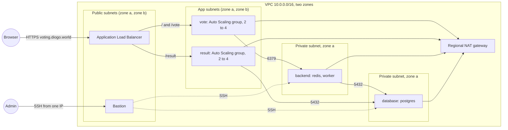

# Voting app on AWS with Terraform and Ansible

A polyglot voting app (Python vote, Node result, .NET worker, Redis, Postgres) deployed to AWS: vote and result in Auto Scaling groups behind an HTTPS load balancer, Redis, the worker and Postgres on private hosts behind a dedicated bastion. Terraform builds the network, hosts and load balancer, Packer bakes the app image, and Ansible configures the fixed hosts through the bastion. Forked from [Pokfinner/ironhack-project-1](https://github.com/Pokfinner/ironhack-project-1), itself based on Docker's example voting app.

## Architecture



| Part | Where | Runs | Accepts |
|---|---|---|---|
| Load balancer | public subnets, both zones | HTTPS listener, HTTP redirect | 80 and 443 from anywhere |
| Bastion | public subnet, zone a | SSH jump host only | SSH from the admin IP |
| vote group | app subnets, both zones | vote (80) | 80 from the load balancer, SSH from the bastion |
| result group | app subnets, both zones | result (80) | 80 from the load balancer, SSH from the bastion |
| backend | private subnet, zone a | redis (6379), worker | 6379 from vote, SSH from the bastion |
| database | private subnet, zone a | postgres (5432) | 5432 from backend and result, SSH from the bastion |

Redis, the worker and Postgres are single instances in one zone: the load balancer and the groups protect the web tier, not the data tier.

Images: `nitramabuar/vote`, `nitramabuar/result`, `nitramabuar/worker` on Docker Hub. A fork that changes `vote/`, `result/` or `worker/` builds and pushes its own images, then sets `dockerhub_user` in `infra/main/terraform.tfvars` and exports `DOCKERHUB_USER` for compose. Otherwise it runs the public images above.

## Run it locally

```bash
export DOCKERHUB_USER=your-user   # optional, defaults to nitramabuar
docker compose up -d --wait
# vote: http://localhost:8080  result: http://localhost:8081
docker compose down -v
```

## Checks

`scripts/check.sh` runs every check: `terraform fmt` and `terraform validate`, `packer fmt` and `packer validate`, TFLint with the AWS ruleset, Checkov (Terraform, Ansible, the Dockerfiles, the workflow and committed secrets), ansible-lint, ShellCheck, hadolint and actionlint. It reports every failure in one run and exits non-zero if any check failed. GitHub Actions runs the same script on every push and pull request (`.github/workflows/checks.yml`). The workflow pins the versions of Terraform, Packer, ansible-core, TFLint, Checkov, ansible-lint, hadolint and actionlint, takes ShellCheck from the runner image, and locks its actions with GitHub's workflow lockfile. GitHub runs no workflows on a fork until you enable them in its Actions tab.

```bash
tflint --init   # once, fetches the TFLint AWS ruleset
scripts/check.sh
```

An accepted finding carries its reason in a `checkov:skip` or `hadolint ignore` comment next to the code.

## Deploy to AWS

Requirements: Terraform 1.11 or newer, Packer 1.16 or newer, a public Route 53 hosted zone in the account, Ansible (ansible-core 2.17 or newer, with boto3 in its Python for the Parameter Store lookup, for example from `uv tool install ansible-core --with boto3`), `ssh-keygen` for step 0, and AWS credentials that can manage S3, VPC, EC2, IAM roles and policies, CloudWatch Logs and alarms, SNS, Route 53, ACM, Elastic Load Balancing and Auto Scaling, and read the SSM parameter that holds the Ubuntu AMI and write and read the database password parameter (`ssm:GetParameter`, `ssm:PutParameter`). The stack bills by the hour while it is up (the NAT gateway, the load balancer, the three fixed instances and the app groups), so tear it down when you are done.

To use your own names, set `owner`, `name_prefix` and, if you want, `region` in both modules: in `infra/main/terraform.tfvars`, and for `infra/bootstrap`, which has no tfvars example, with `-var` or a `terraform.tfvars` of your own. The course account only allows `us-east-1` and `eu-central-1`, so no other region passes validation.

A fresh fork needs its own SSH key. The database password needs no step: Terraform generates it, 32 letters and digits (the result app puts it unencoded in a `postgresql://` URL and the worker in a `;` separated connection string), and writes it to SSM Parameter Store through a write-only argument, so it never reaches the Terraform state. Ansible reads it from there with your AWS credentials.

```bash
# 0. Your own SSH key (once)
ssh-keygen -t ed25519 -N '' -f ~/.ssh/ironhack-project-1

# 1. State bucket (once)
cd infra/bootstrap && terraform init && terraform apply   # also writes infra/main/backend.hcl

# 1b. App server image (once, and again after a change to the roles). Set name_prefix
#     and region in infra/image/app.pkr.hcl, or pass them with -var, if you changed
#     them for infra/main.
packer init infra/image && packer build infra/image

# 2. Network and hosts
cd ../main
cp terraform.tfvars.example terraform.tfvars   # then set admin_cidr to your public IPv4 as a /32, e.g. 203.0.113.7/32, domain_zone to your Route 53 zone, and alarm_email to your address
terraform init -backend-config=backend.hcl && terraform apply
# AWS emails alarm_email a confirmation link; alarms arrive only after you confirm it

# 3. Containers
cd ../..
ansible-galaxy collection install -r ansible/requirements.yml
ansible-playbook -i ansible/inventory.ini ansible/site.yml
ansible-playbook -i ansible/inventory.ini ansible/smoke.yml
```

`terraform -chdir=infra/main output` prints `app_url` and `result_url`.

## Monitoring

- Container logs go to CloudWatch Logs through Docker's `awslogs` log driver, set as the default in `/etc/docker/daemon.json` by the `docker` role: log group `martin-containers`, one stream per container named `<container>/<short id>`. `docker logs` still works.
- The CloudWatch agent (role `cloudwatch`) sends memory and root disk use, and `/var/log/auth.log` to `martin-ssh`.
- `container-metrics.sh` runs every minute from a systemd timer and reports `containers_down` and `container_restarts` to the agent over StatsD. Plain Docker on EC2 has no built-in container metrics in CloudWatch.
- A VPC flow log sends rejected traffic to `martin-vpc-flow`.
- Alarms email through the SNS topic `martin-alarms`: for the backend and database hosts, CPU above 80 percent, memory above 90 percent, a container down (or the host silent) and a container restart; for the bastion, a heartbeat; for the load balancer, unhealthy targets in each target group and any load balancer 5XX. The vote and result Auto Scaling instances have no per-host alarms.
- The instance role writes only to this stack's log groups and the `CWAgent` metric namespace, and an instance metadata hop limit of 1 keeps it out of the containers.

```bash
aws logs tail martin-containers --follow
aws logs tail martin-ssh --since 1h
aws cloudwatch describe-alarms --alarm-name-prefix martin- --query 'MetricAlarms[].[AlarmName,StateValue]' --output table
```

The brief suggests the CloudWatch agent for container logs, but with a wildcard path the agent only ships the most recently written file, and Docker reserves its JSON log files for itself, so the log driver ships them instead.

## Design notes

- Remote state lives in S3 with S3 native locking (`use_lockfile`). Terraform has deprecated DynamoDB based locking.
- Security groups chain tier to tier: vote and result accept HTTP only from the load balancer, Redis only accepts vote, Postgres only result and the worker, and every host accepts SSH only from the bastion, which accepts it only from the admin IP. Terraform removes the allow-all egress rule AWS adds to new security groups, so every outbound flow is declared.
- Ansible reaches every host with `ProxyJump` through the bastion, using an `ssh_config` that Terraform generates. Ansible runs on the admin's machine, so neither the SSH key nor any secret is stored on the internet-facing bastion. There is no `ansible.cfg`, because Ansible ignores one in a world-writable directory (as on a WSL checkout of a Windows drive); the SSH settings live in `ansible/inventory.ini`, so they apply only with this inventory.
- AWS documents ways to reach private hosts without any bastion: Session Manager ("secure node management without the need to open inbound ports, maintain bastion hosts, or manage SSH keys") and EC2 Instance Connect Endpoint. This project uses a bastion because the course asks for one.
- Docker is installed from Docker's own apt repository rather than Ubuntu's `docker.io` package.
- The Postgres password lives only in SSM Parameter Store as a SecureString and is never written to a log: result and the worker log the host, user and database only. Terraform writes it with a write-only argument, so it is never stored in the state, and Ansible reads it at run time. To rotate it, bump `db_password_version` in `infra/main/secrets.tf` and apply, set the new value in Postgres with `ALTER USER` (sent on stdin, never on a command line), then rerun `site.yml`; from stage 4 on, the result group also needs an instance refresh, because its instances read the password once at boot. Change any other setting of the parameter only together with a version bump: the provider resends the value only when the version changes. Redis has no password (the vote app cannot send one), so its security group is its only protection.
- Votes survive a database restart: the worker moves each vote from `votes` to a `votes:processing` list in Redis and removes it only after Postgres has stored it, the pattern the Redis `LMOVE` docs describe for a reliable queue. Votes that cannot be read or that Postgres refuses land in `votes:failed`. result polls through its connection pool, so it recovers on its own.
- The root volumes are encrypted, and every app container runs as an unprivileged user.

## Load balancer and HTTPS

- An Application Load Balancer in both public subnets answers on `https://<app_hostname>.<domain_zone>/` with a certificate from AWS Certificate Manager, validated by DNS in the Route 53 zone you name in `domain_zone`. Port 80 redirects to HTTPS, and responses carry `Strict-Transport-Security`. The TLS policy is `ELBSecurityPolicy-TLS13-1-2-Res-PQ-2025-09`, the one AWS recommends.
- `/` and `/vote` go to vote, `/result` and everything under it to result, including its Socket.IO connection. result's target group keeps a browser on one instance with a load balancer cookie, which Socket.IO needs if it falls back from WebSocket to long-polling.
- vote and result run in one Auto Scaling group each, two to four instances across both zones, launched from the image `infra/image` bakes. A new instance only pulls and starts its container; result reads the database password from Parameter Store at boot. vote scales on requests per instance, result on CPU. The groups launch a replacement before they terminate an instance.
- To reach an app instance for debugging: `ssh -F ansible/ssh_config <private IP>` (it jumps through the bastion). A replacement that reuses an IP is refused until you run `ssh-keygen -f ansible/known_hosts -R <ip>`.
- Alarms email you when a target fails its health check or the load balancer itself returns 5xx. A container that restarts fast enough to pass every health check shows only in the `container_restarts` metric.

## Tear down

```bash
cd infra/main && terraform destroy
aws ec2 describe-images --owners self --filters 'Name=name,Values=martin-app-*'
# then, for each image id and each snapshot id it lists:
aws ec2 deregister-image --image-id <image id>
aws ec2 delete-snapshot --snapshot-id <snapshot id>
cd ../bootstrap && terraform destroy
```
